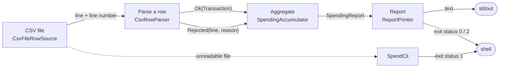

# Architecture

## Pattern and why

**Ports and adapters (hexagonal) in four layers.** The tool has one boundary that matters, the input file, and one that is only presentation, the terminal. The domain (money, rows, aggregation) knows neither; the application layer owns a single port, `RowSource`; the CSV adapter implements it; the command line wires them together. This keeps the exact-money rules and the aggregation testable without a file, and lets the file format change without touching them. Rows are modeled as a **sealed result type** (`ParsedRow`) so bad input is data, and the aggregation is a **streaming fold** so memory does not grow with the file. Each decision has a record in [docs/adr](docs/adr).

## Components

The names follow the lesson's diagram ("From messy rows to a report", group `java Spend.java`).

| Lesson component | Class (package) | Owns |
| --- | --- | --- |
| CSV file | `CsvFileRowSource` (`infrastructure.csv`) | opening the file as UTF-8, stripping a byte-order mark, skipping the header and blank lines, counting lines, turning an unreadable file into `InputUnreadableException` |
| Parse a row | `CsvRowParser`, `CsvFieldSplitter` (`infrastructure.csv`) | quoted fields, column count, date, plain-decimal amount, currency; every failure becomes a `Rejected` with a reason |
| Rejected rows | `ParsedRow.Rejected` (`domain`), kept by `SpendingAccumulator` | line number, raw line, reason; the first N kept, the count exact |
| Aggregate | `SpendingAccumulator`, `BuildSpendingReport` (`domain`, `application`) | exact sums per month and category, the largest purchases, the immutable `SpendingReport` |
| Report | `ReportPrinter`, `SpendCli` (`interfaces.cli`) | the only rounding, the text layout, arguments, exit status |
| Exact money | `Transaction` (`domain`) | the record that refuses a negative or null amount and a blank category, naming the field |
| Never crash | `ParsedRow` (sealed), `InputUnreadableException` | the two kinds of failure: a row (data) and the file (exception) |

## Data flow

Drawn versions of this figure and of the walk-through: [the architecture](docs/diagrams/architecture.svg) and [one run](docs/diagrams/flow.svg).

1. `SpendCli` reads the arguments and the environment into `Settings`, builds the parser for the report currency and the file source, and runs `BuildSpendingReport`.
2. `CsvFileRowSource` opens the file with `Files.lines(path, UTF_8)` and iterates it lazily. Line 1 (the header) is skipped; a byte-order mark glued to line 1 is removed; blank lines are ignored but still counted.
3. For each data line `CsvRowParser.parse(lineNumber, line)` splits the fields (a comma inside quotes stays), checks that there are exactly five, and builds a `Transaction`: ISO date, plain-decimal amount (thousands commas removed first), currency code that must equal the report currency, then the record's own checks (non-negative amount, non-blank category). It returns `Ok` or `Rejected`.
4. `SpendingAccumulator.accept` adds an `Ok` to the month and category sum, offers it to the bounded queue of largest purchases, and records a `Rejected` (counted always, kept up to the cap).
5. `report()` returns an immutable `SpendingReport`: months oldest first, categories largest first (ties by name), the largest purchases biggest first (ties by earlier date).
6. `ReportPrinter` rounds each figure once, half-even, to the currency's minor units and prints the report to standard output. `SpendCli` returns 2 if any row was rejected, else 0. A file that cannot be read prints one line on standard error and returns 1.

## Decisions and trade-offs

- **Sealed `ParsedRow` instead of exceptions** ([ADR 1](docs/adr/0001-bad-rows-are-data-not-exceptions.md)): the exhaustive `switch` makes handling both outcomes a compile-time fact; the cost is one small record per bad row.
- **Exact money, rounded half-even at print time** ([ADR 2](docs/adr/0002-exact-money-rounded-once-at-print-time.md)): totals never drift; the cost is `compareTo` instead of `equals` in comparisons.
- **Streaming with a capped reject list** ([ADR 3](docs/adr/0003-stream-the-file-keep-only-aggregates.md)): constant memory; the printed reject list can be shorter than the reject count, and says so.
- **Hand-written splitter** ([ADR 4](docs/adr/0004-hand-written-csv-splitter.md)): the lesson's teaching point; the format limits are documented and the adapter is replaceable.
- **Exit status 2 for rejects:** a script can tell "ran fine" from "ran, but some rows need attention" without parsing text. 1 and 64 are kept for a broken file and wrong usage.
- **Logs to standard error, report to standard output:** the report can be piped while the logs stay available.

## Failure modes the lesson teaches, and where the code shows them

| Failure | How it is handled | Where to see it |
| --- | --- | --- |
| `line.split(",")` splits `"1,204.50"` in two and rejects a good row | quote-aware splitter | `CsvFieldSplitter`; `make quote-check` removes the handling and exactly one test fails |
| `double` money drifts by a cent | `BigDecimal` from strings, no rounding while adding | `make cents` prints 0.30 |
| `NumberFormatException` caught after its parent `IllegalArgumentException` gives the wrong reason | catch order, with a comment; line 13 says `amount is not a number: 'sixty'` | `CsvRowParser.parse` |
| `Currency.getInstance("US$")` throws with no message, so the reason would print `null` | caught and rethrown with `unknown currency code 'US$'` | line 25 of the sample |
| A missing charset works here and breaks elsewhere | `StandardCharsets.UTF_8` named; a BOM stripped | `make bom` |
| An unreadable file | one line on standard error, exit 1, no stack trace | `SpendCliTest.aMissingFileExitsOneWithOneLineOnStandardError` |
| Rounding in the middle of a sum | rounding only in `ReportPrinter` | `SpendCliTest.halfEvenRoundingIsAppliedOnlyWhenPrinting` |

### The bug story

While writing the sample I typed `1,204.50` unquoted on line 18 and the tool said `expected 5 columns, found 6` for a row I believed was fine. The row was not fine: an amount with a thousands comma and no quotes really is six columns. The quoted version on line 4 is the good row, and the first draft of the splitter (`String.split`) rejected it. Writing the quoted-amount test first showed the difference, and removing the quote handling later (`make quote-check`) fails that one test and no other.

## Limits of the teaching build against a production one

- A line-based reader: no newline inside a quoted field, no `""` escape (use a CSV library behind `RowSource`).
- One input file, one report currency, no conversion, no locale-aware parsing of `1.204,50`.
- Dates in one format; no time zones (a card export posts calendar days).
- The report is text only; there is no JSON or CSV output mode.

## How to extend it

- **A new input** (a bank's JSON export, a database): implement `RowSource` in `infrastructure/`, wire it in `SpendCli`.
- **A new output** (JSON): add a printer next to `ReportPrinter` in `interfaces/`; the `SpendingReport` value is the contract.
- **A new rule** (reject amounts over a limit): add it to `Transaction`; its message becomes the reason automatically.
- **Currency conversion:** add a `RateTable` port to `application`, convert in the parser's `Ok` path, and decide, in an ADR, whether each converted row is rounded or only the total.
