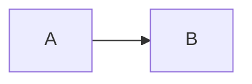
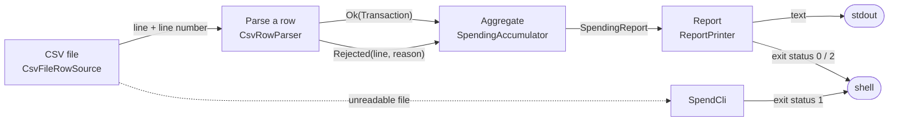

# Markdown and Mermaid

## 1. What it is

**Markdown** is a way of writing formatted text using only ordinary characters, so the file is readable as plain text and also renders nicely on GitHub: a `#` at the start of a line makes a heading, `-` a bullet, backticks mark code, `|` draws tables. **Mermaid** is a text notation for diagrams that can live inside a Markdown file: you describe boxes and arrows in words, and the viewer draws them.

## 2. Why this repository uses it

The repository promises documentation that lives with the code: a README, an architecture note with a diagram, a changelog and short decision records. Markdown keeps them in git next to the code and diff-able.

## 3. Where it appears

| File | What it is | Lines |
| --- | --- | --- |
| `ARCHITECTURE.md` | the design: layers, data flow, decisions | 80 |
| `CHANGELOG.md` | what each release adds | 19 |
| `README.md` | the front page: what it is, how to run it, the Done-when proofs | 166 |
| `docs/adr/0001-bad-rows-are-data-not-exceptions.md` | an architecture decision record (context, decision, alternatives, consequences) | 20 |
| `docs/adr/0002-exact-money-rounded-once-at-print-time.md` | an architecture decision record (context, decision, alternatives, consequences) | 19 |
| `docs/adr/0003-stream-the-file-keep-only-aggregates.md` | an architecture decision record (context, decision, alternatives, consequences) | 19 |
| `docs/adr/0004-hand-written-csv-splitter.md` | an architecture decision record (context, decision, alternatives, consequences) | 18 |

## 4. How it works underneath

1. A Markdown file is plain text. A renderer (GitHub, an editor preview, a static-site tool) reads the characters and produces formatted output; nothing is compiled.
2. Rendering differs a little between tools, so the files use only the common features listed below.
3. A Mermaid block is not Markdown at all: the renderer hands the text between the fences to the Mermaid library, which lays out and draws the graph in the browser.
4. The files that other files link to (`ARCHITECTURE.md`, `docs/adr/...`) use relative links, which work on GitHub and in a clone.

## 5. Walkthrough of this repository's use

Every Markdown feature used in this repository, with a real example:

### Headings

```markdown
## Prerequisites
```

One to six `#` characters at the start of a line, then a space, make a heading; more `#` means a deeper level. `README.md` has these top-level sections:

- Prerequisites
- Setup, run, test, stop
- Done when: the lesson's checklist and the proof for each line
- Stretch goals
- What is simplified for teaching
- Project structure
- Quality gates
- Troubleshooting
- Author and license

### Inline code and emphasis

```markdown
- `tech/`: 27 notes that teach every technology of this repository from zero, through its own files, with an index in `tech/README.md`.
```

Backticks make `code` in a monospace font. `**bold**` and `*italic*` use asterisks.

### Lists

```markdown
### Added

- `tech/`: 27 notes that teach every technology of this repository from zero, through its own files, with an index in `tech/README.md`.
```

A line starting with `- ` is an item of a bulleted list; `1.` starts a numbered list. Indenting an item under another nests it.

### Links

```markdown
All notable changes to this project are recorded here. The format follows [Keep a Changelog](https://keepachangelog.com/en/1.1.0/) and the project uses [Semantic Versioning](https://semver.org/).
```

`[text](address)` is a link.

### Tables

```markdown
| | |
| --- | --- |
```

Lines of cells separated by `|`, with a second line of `---` after the header, make a table.

### Code blocks

````markdown
```bash
make test
```
````

A line of three backticks, optionally followed by a language name, starts a block of code that is shown literally; another line of three backticks ends it.

### Mermaid diagrams

````markdown

````

A code block marked `mermaid` holds a diagram in Mermaid notation (see below); GitHub and many viewers draw it as a picture.

### The Mermaid diagram of this repository

`ARCHITECTURE.md` contains this diagram:



Reading it: `flowchart LR` means a flow chart drawn left to right (`TD` would be top to bottom). A line such as `name["text"]` declares a box: `name` is an identifier used to connect boxes, the quoted text is the label shown, and `<br/>` inside a label is a line break. `a -->|"text"| b` draws an arrow from box `a` to box `b` with the label `text` on it. `a -. "text" .-> b` draws a dotted arrow, used here for something that happens off the main path. `name(["text"])` draws a rounded box (here for standard output and the shell). An identifier can be used before or after its box is declared; the arrows refer to boxes by identifier.

## 6. Try it yourself

- Open `README.md` on GitHub or in an editor preview. Expected: headings, tables and code blocks rendered.
- `grep -n '^## ' README.md`. Expected: the section titles listed above.
- Edit the Mermaid block in a scratch copy (rename a label) and view the preview. Expected: the diagram changes.
- `ls docs/adr/`. Expected: the numbered decision records.

## 7. Mistakes people make

- A table row with a different number of `|` than the header: the table breaks.
- Forgetting the blank line before a list or table: it may render as plain text.
- A Mermaid label containing quotes or brackets without quoting: the diagram fails to draw.
- Absolute links to a local path: they break for other readers; use relative links.
- Letting documentation drift from the code: the Done-when table in the README is checked against real runs.

## 8. Check yourself

1. What does a line starting with `##` mean?
   **Answer:** A level-2 heading.
2. How do you write a code block?
   **Answer:** Between two lines of three backticks.
3. What is Mermaid?
   **Answer:** A text notation for diagrams inside Markdown code blocks.
4. What is an ADR?
   **Answer:** A short record of one design decision: context, decision, alternatives, consequences.
5. Why are there relative links?
   **Answer:** They work on GitHub and in a clone, wherever the repository is.

## 9. Further reading

- CommonMark specification: https://spec.commonmark.org/
- GitHub Flavored Markdown: https://github.github.com/gfm/
- Mermaid flowcharts: https://mermaid.js.org/syntax/flowchart.html
